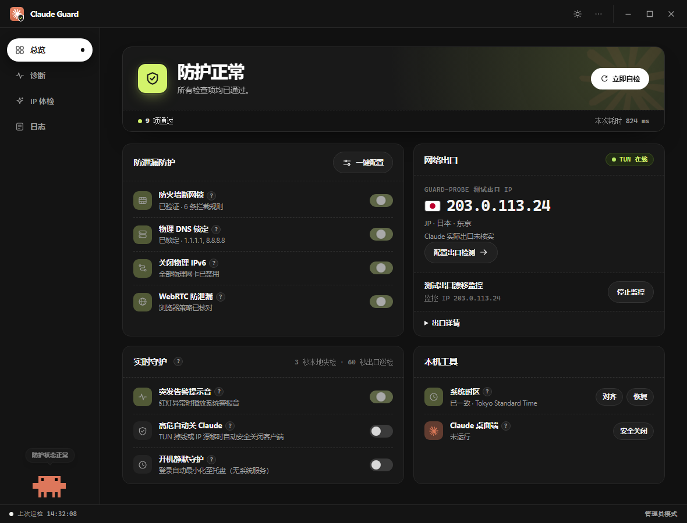
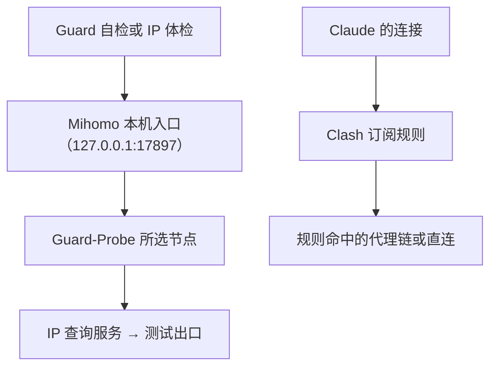

<p align="center">
  
</p>

# Claude Guard

**Claude Guard 提供网络自检、出口漂移提醒和 Claude Desktop 断网保护。** 搭配本机的 **Clash Verge Rev（Mihomo）** 使用，支持 Windows 和 macOS 15 及更新版本。

[GitHub Releases](https://github.com/Octy-10/ClaudeGuard/releases/latest) · [macOS 安装与使用](#macos-安装与使用) · [Windows 首次配置](#首次配置) · [常见问题](#常见问题) · [紧急恢复](#紧急恢复)

## 界面预览



<sub>界面取自项目代码，巡检状态与 IP 均为演示数据。</sub>

| 入口 | 可以做什么 |
| --- | --- |
| **总览** | 立即自检、一键配置防护、调整单项开关和启动出口漂移监控。 |
| **诊断** | 展开九项检查详情，查看异常原因与检查范围。 |
| **IP 体检** | 查看测试节点的出口属性、代理记录与数据源结果。 |
| **日志** | 查看当前会话中的系统变更、巡检和告警记录。 |

## 下载与运行

准备好 **Windows、Microsoft Edge WebView2 Runtime** 和已能正常联网的 **Clash Verge Rev**。调整防火墙、网卡或浏览器策略时需要 Windows 管理员权限。

1. 打开 [最新发布页](https://github.com/Octy-10/ClaudeGuard/releases/latest)，在 **Assets** 中下载 `ClaudeGuard.exe`。
2. 双击运行。要应用系统防护时，在窗口中选择 **以管理员重启** 并确认 Windows 的 UAC 提示。
3. 如需核验下载文件，可用下方命令计算 SHA-256，并与同一发布页的 `SHA256SUMS.txt` 比对。

```powershell
Get-FileHash .\ClaudeGuard.exe -Algorithm SHA256
```

## macOS 安装与使用

正式安装包用于 macOS 15 及更新版本。Apple Silicon 选 `ClaudeGuard-macOS-arm64.pkg`，Intel 选 `ClaudeGuard-macOS-x86_64.pkg`。签名安装包发布后可在 [GitHub Releases](https://github.com/Octy-10/ClaudeGuard/releases/latest) 获取。

1. 安装签名 `.pkg`，从「应用程序」打开 Claude Guard。在工具菜单复制 **Clash 本机代理与出口检测脚本**。备份 Clash 原有脚本，再将专用脚本保存到 **Clash Verge → 订阅 → 全局扩展脚本** 并重新应用订阅。
2. 在 Clash 使用 **规则模式**，分别为 **Guard-Probe**（自检和 IP 体检）与 **Guard-Claude**（Claude Desktop）选择远端节点。两组首次应用时默认使用 `REJECT`。需要检测 TUN 时，在 Clash 中单独开启。
3. 完全退出 Claude Desktop，在 Guard 开启 **Claude Desktop 断网锁**，按 macOS 提示批准网络扩展。回到 Guard 点击 **受保护地启动**。断网锁包含 Claude Desktop 的应用级保护，以及跨应用的已知 Anthropic 地址段拦截。
4. 按需开启 DNS、IPv6、登录自动启动和告警。系统网络变更会请求管理员授权。WebRTC 描述文件由 **系统设置 → 通用 → 设备管理** 安装或移除，修改后需重启浏览器。最小化窗口或从菜单栏隐藏窗口可继续巡检。

打开 **紧急恢复** 可按备份还原 DNS、IPv6 和时区，并移除 Guard 的网络过滤配置。若安装过 Guard 的 WebRTC 描述文件，请在「设备管理」中移除。更新时从工具菜单检查版本，退出 Guard 后打开新安装包。当前保护范围、安装包构建及验证见 [macOS 发行说明](docs/macos-release.md)。

可在 Mac 上使用 Python 3.10 或更新版本运行源码诊断。命令在仓库根目录执行。

```bash
python3 -m venv .venv
source .venv/bin/activate
python -m pip install -r requirements.txt
python app.py
```

`python app.py --doctor` 在终端执行一次自检。系统防护通过签名安装包启用。

## 首次配置

1. **应用扩展脚本。** 在 Guard 的 **总览 → 配置出口检测** 点击 **复制脚本**。先备份已有全局扩展脚本，再到 **Clash Verge → 订阅 → 全局扩展脚本** 粘贴完整脚本，保存并重新应用当前订阅。
2. **选择测试节点。** 将 Clash 切到 **规则模式（Rule）**。脚本会配置 TUN、自动路由、严格路由和 DNS，并关闭 Clash 顶层及 DNS 的 IPv6。打开 Clash 的 **Guard-Probe** 策略组，手动选择一个可用节点。
3. **确认诊断范围。** 回到 Guard 点击 **立即自检**，看到 **测试出口 IP** 后，可展开诊断详情，或到 **IP 体检 → 开始体检** 查看更多信息。要核对 Claude 的实际连接，请打开 Clash 的 **连接** 页，查看对应连接所用的规则与代理链。
4. **按需开启防护和监控。** 点击 **一键配置** 会应用断网锁、物理网卡 DNS、物理网卡 IPv6 和浏览器 WebRTC 四项设置。点击 **开始监控** 会记录当前测试出口 IP，后续检测到变化时提醒你。窗口右上角的 `×` 会将 Guard 收到系统托盘。

### 测试出口怎么来的



Guard 的体检结果与漂移提醒对应 **Guard-Probe 所选节点**。Claude 的连接依照 Clash 当前规则和策略组分流，两条路径可能使用不同出口。

## 防护能力

| 功能 | 作用 |
| --- | --- |
| **断网锁（Kill Switch）** | 在 Windows Defender 防火墙中添加针对物理网卡的规则，拦截已知 Anthropic 地址段，以及识别到的 Claude 桌面程序直连。适用范围可在诊断中核对。 |
| **物理网卡 DNS** | 保存原有 DNS 设置，将物理网卡 DNS 设为 `1.1.1.1` 和 `8.8.8.8`。 |
| **物理网卡 IPv6** | 保存绑定状态并关闭物理网卡的 IPv6 绑定。Clash 内的 IPv6 设置由扩展脚本处理。 |
| **浏览器 WebRTC** | 为 Chrome、Edge 和 Firefox 应用 WebRTC 策略，并备份相关原值。 |
| **巡检与告警** | 检查 TUN、测试出口、断网锁、物理 DNS、IPv6、WebRTC、时区、Clash 配置和冲突项。可选开启提示音或高危联动关闭 Claude 桌面端。 |
| **系统时区与桌面端操作** | 可手动按测试出口对齐 Windows 时区，也可按需关闭识别到的 Claude 桌面进程。 |

## 常见问题

| 遇到的问题 | 可以先查这里 |
| --- | --- |
| Clash 里找不到 **Guard-Probe** | 确认脚本已保存，重新应用了当前订阅，并检查 Clash 是否报告脚本错误。 |
| 有 **Guard-Probe**，但拿不到测试 IP | 首次加载或找不到候选节点时，该组默认使用 `REJECT`。请手动选择一个可用节点，再回到 Guard 自检。脚本从订阅 YAML 的 `proxies` 中读取候选节点，只有 `proxy-providers` 的订阅可能没有候选。 |
| 看到测试 IP，怎样确认 Claude 的连接？ | 在 Clash 的 **连接** 页查看 Claude 对应连接的规则与代理链。`127.0.0.1:17897` 是 Guard 测试专用的本机入口。 |
| 虚拟机能否继续使用原代理端口？ | `17897` 仅绑定本机回环地址。虚拟机继续使用原本配置的局域网 `mixed-port`。 |
| 切换测试节点后出现漂移提示 | 核实新节点后，点击 **停止监控 → 开始监控**，用当前测试出口重新建立监控基准。 |
| 防护开关应用失败 | 确认 Guard 以管理员权限运行，再查看 **诊断** 或 **日志** 中的失败项目。 |
| 如何更新？ | 在标题栏 **··· → 检查更新** 查看新版本。EXE 版可下载并校验 SHA-256 后重启更新，源码版可从 [GitHub Releases](https://github.com/Octy-10/ClaudeGuard/releases) 手动获取新版本。 |

## 紧急恢复

在标题栏 **··· → 紧急恢复** 中确认恢复。Guard 会移除自己添加的断网锁规则，并按备份恢复 DNS、IPv6、WebRTC 和时区。源码用户也可以双击 [`rescue.bat`](rescue.bat)，或在管理员终端运行 `python app.py --rescue`。

如果还有失败项，请保留 `%USERPROFILE%\.claude-guard\backup.json` 并查看恢复结果。旧版 WebRTC 备份可能缺少策略原值，遇到此提示时请手动核对浏览器组策略。若要撤回 Clash 侧的改动，请恢复之前保存的全局扩展脚本，再重新应用订阅。

## 从源码运行

安装 **Python 3.10 或更高版本**，在 Windows PowerShell 执行以下命令。

```powershell
git clone https://github.com/Octy-10/ClaudeGuard.git
Set-Location ClaudeGuard
python -m pip install -r requirements.txt
python app.py
```

也可以双击 [`start_guard.bat`](start_guard.bat) 以管理员权限启动。运行 `python app.py --doctor` 可在终端执行一次自检，运行 `python verify.py` 可查看命令行环境检查，运行 `python -m unittest discover -s tests -v` 可执行 Python 单元测试。

| 路径 | 内容 |
| --- | --- |
| [`app.py`](app.py) / [`guard/`](guard/) | 桌面入口、自检、系统防护、配置备份和更新逻辑。 |
| [`web/`](web/) | pywebview 加载的本地界面。 |
| [`clash-verge-override.js`](clash-verge-override.js) | Clash Verge 全局扩展脚本与 Guard-Probe 配置。 |
| [`tests/`](tests/) | 防护、恢复、更新及脚本的回归测试。 |

## 数据与使用范围

系统设置与备份保存在本机。Guard 的桌面界面通过进程内桥接调用后端。出口与 IP 体检会访问第三方 IP 查询服务，版本检查与下载会访问 GitHub Releases。防护结果用于诊断本机网络条件，Claude 账号状态与服务可用性由 Anthropic 决定。

发现问题时，可在 [GitHub Issues](https://github.com/Octy-10/ClaudeGuard/issues) 附上 Guard 版本、Windows 版本、Clash Verge Rev 版本和相关诊断项。公开提交前，请遮挡实际 IP、订阅地址和账号信息。
